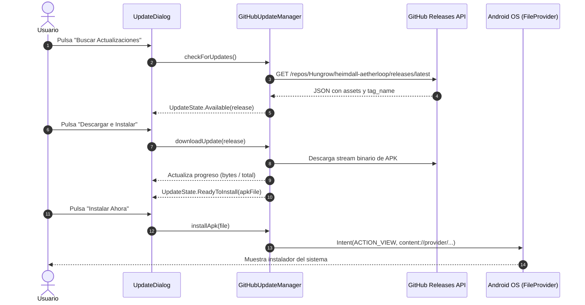

# Arquitectura Técnica y Decisiones de Diseño

Este documento describe detalladamente la arquitectura interna, las fórmulas matemáticas y los patrones de rendimiento implementados en **Heimdall: AetherLoop**.

---

## 1. Geometría Paramétrica de la Pista ([`BifrostTrack`](file:///c:/Users/hungr/Desktop/sandloop/app/src/main/java/com/heimdall/aetherloop/game/physics/BifrostTrack.kt))

Para garantizar que las vasijas se desplacen con suavidad absoluta alrededor del circuito cerrado, la pista se modela matemáticamente como una curva compuesta continua (estadio redondeado):

* **4 Tramos Rectos**:
  * Tramo Superior Horizontal: $y = \text{top}$, $x \in [\text{left} + r, \text{right} - r]$. Es la zona de recolección donde las vasijas interceptan el flujo de las fisuras celestiales.
  * Tramo Inferior Horizontal: $y = \text{bottom}$, $x \in [\text{right} - r, \text{left} + r]$.
  * Dos Tramos Verticales (Izquierda y Derecha) de enlace.
* **4 Curvas de Esquina**: Arcos de circunferencia de radio $r$ parametrizados mediante coordenadas polares:
  $$x(\theta) = c_x + r \cos(\theta), \quad y(\theta) = c_y + r \sin(\theta)$$
* **Mapeo de Progreso Normalizado $t \in [0, 1)$**:
  Dada una distancia acumulada $s = t \cdot L_{\text{total}}$, el motor calcula de forma analítica en $O(1)$ la posición exacta $(x, y)$ y el vector tangente $\vec{T} = (\Delta x, \Delta y)$, a partir del cual se orienta la vasija con $\theta = \text{atan2}(\Delta y, \Delta x)$.

---

## 2. Motor de Partículas y Reutilización de Memoria ([`ParticleEngine`](file:///c:/Users/hungr/Desktop/sandloop/app/src/main/java/com/heimdall/aetherloop/game/physics/ParticleEngine.kt))

En un juego donde cientos de partículas caen continuamente, la asignación dinámica de objetos en el heap provocaría pausas frecuentes de Garbage Collection (*jank* o *stutter*).

### Patrón Object Pool
* Se implementa un [`ParticlePool`](file:///c:/Users/hungr/Desktop/sandloop/app/src/main/java/com/heimdall/aetherloop/game/model/Particle.kt) pre-reservado de 500 partículas mutables.
* Las partículas inactivas se recuperan en $O(1)$ sin realizar `new Particle()`.
* Al colisionar o caer fuera de la pantalla, la partícula se marca inactiva y se reintegra al pool.

### Integración Física
La integración se realiza por método de Euler explícito acotado:
$$v_y(t + \Delta t) = v_y(t) + g \cdot \Delta t$$
$$x(t + \Delta t) = x(t) + v_x(t) \cdot \Delta t$$
$$y(t + \Delta t) = y(t) + v_y(t) \cdot \Delta t$$
Donde $\Delta t$ se acota estrictamente entre $1\,\text{ms}$ y $50\,\text{ms}$ para evitar inestabilidades o efecto túnel en caídas de framerate.

---

## 3. Síntesis Procedural de Audio ASMR ([`SoundSynthesizer`](file:///c:/Users/hungr/Desktop/sandloop/app/src/main/java/com/heimdall/aetherloop/core/SoundSynthesizer.kt))

Para garantizar que el juego funcione sin depender de códecs de compresión, decodificación de archivos o retardos de carga de assets:
* Se utiliza [`AudioTrack`](https://developer.android.com/reference/android/media/AudioTrack) en modo estático a una frecuencia de muestreo de $44.1\,\text{kHz}$.
* Los tonos se generan mediante funciones senoidales puras moduladas por una envolvente exponencial decreciente:
  $$s(t) = A \cdot \sin(2\pi f t) \cdot e^{-\lambda t}$$
* Las frecuencias se seleccionan de una escala pentatónica armoniosa:
  * Do5 ($523.25\,\text{Hz}$), Re5 ($587.33\,\text{Hz}$), Mi5 ($659.25\,\text{Hz}$), Sol5 ($783.99\,\text{Hz}$), La5 ($880.00\,\text{Hz}$), Do6 ($1046.50\,\text{Hz}$).
* Cuando una vasija se completa, se genera un acorde dual con armónico shimmer ($880\,\text{Hz} + 1320\,\text{Hz}$) simulando una campana tibetana / cristalina.

---

## 4. Pipeline de Actualización OTA desde GitHub ([`GitHubUpdateManager`](file:///c:/Users/hungr/Desktop/sandloop/app/src/main/java/com/heimdall/aetherloop/updater/GitHubUpdateManager.kt))

El flujo de actualización en caliente se compone de 4 etapas:

---

## 5. Motor de Combate Naval Vikingo Arkanoid ([`VikingArkanoidEngine`](file:///c:/Users/hungr/Desktop/sandloop/app/src/main/java/com/heimdall/aetherloop/game/engine/VikingArkanoidEngine.kt))

En la versión **v2.0.0**, el juego evoluciona a un sistema de combate Arkanoid de alta reactividad táctica:

### Mecánica de Rebote Angular en la Pala-Escudo
Para permitir un control estratégico del ángulo de tiro sin depender de física compleja:
$$\Delta x_{\text{rel}} = \frac{x_{\text{esfera}} - x_{\text{pala}}}{W_{\text{pala}} / 2} \in [-1, 1]$$
$$\theta = \Delta x_{\text{rel}} \cdot \theta_{\max}, \quad \text{donde } \theta_{\max} = 65^\circ \ (1.134\,\text{rad})$$
$$v_x = v \cdot \sin(\theta), \quad v_y = -v \cdot \cos(\theta)$$
Los impactos en los extremos de la pala proyectan la esfera con ángulos agudos rasantes, ideales para alcanzar drakkars protegidos en las esquinas superiores del fiordo.

### Detección y Resolución de Colisiones Círculo-AABB
El [`CollisionEngine`](file:///c:/Users/hungr/Desktop/sandloop/app/src/main/java/com/heimdall/aetherloop/game/physics/CollisionEngine.kt) calcula el punto más cercano del rectángulo delimitador de cada nave a la esfera:
$$x_{\text{cercano}} = \text{clamp}(x_{\text{esfera}}, \text{left}, \text{right})$$
$$y_{\text{cercano}} = \text{clamp}(y_{\text{esfera}}, \text{top}, \text{bottom})$$
$$\text{distancia}^2 = (x_{\text{esfera}} - x_{\text{cercano}})^2 + (y_{\text{esfera}} - y_{\text{cercano}})^2$$
Si $\text{distancia}^2 \le R_{\text{esfera}}^2$, se registra impacto, decrementando los puntos de vida de la nave, generando partículas de astillas de madera y calculando la normal de rebote.

### Sistema de Balistas Gemelas y Fuego de Área
* **Balistas**: Torretas láser que disparan proyectiles verticales directos a $1400\,\text{px/s}$.
* **Fuego de Surtr**: Al impactar, desencadena una onda expansiva de radio $120\,\text{px}$ que inflige 2 de daño a todas las naves dentro del perímetro.
* **Perforación Mjölnir**: La esfera electrificada atraviesa armaduras sin invertir su vector de velocidad vertical $v_y$.

